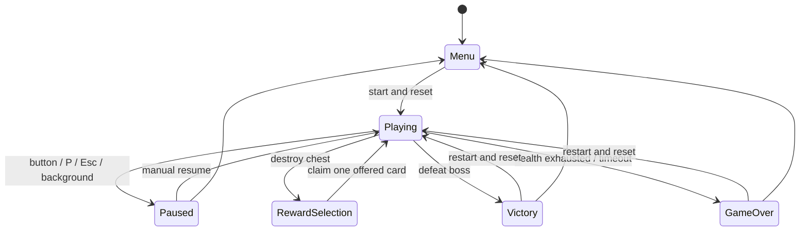

# MVP architecture and invariants

The first theme, **Grail Gone Rogue / 圣杯失控中**, is an original 60–90 second vertical shooter with run-local card growth. Content remains deliberately small: two regular enemies, one boss and seven cards. The original fantasy framing and absurd card descriptions are retained; borrowed characters, logos and music are not used.

## Boundaries

- `src/game/world.ts` owns the run. It imports no Phaser, DOM or Bun APIs. Seconds, logical coordinates and an injected run seed determine the simulation.
- `src/game/config.ts` owns the 450 × 800 field, lower 28% movement bounds, schedules and object budgets.
- `src/game/systems/` owns movement, swept collisions and damage. A 1/120-second accumulator makes 30/60/144 Hz updates equivalent. Frame gaps are capped at 100 ms; hidden pages never catch up in one burst.
- `src/game/scenes/` adapts the model to Phaser 4. Procedural textures, the static starfield and the rotating sigil are generated once; image objects and simulation entities are reused. Decorative ship wings exceed the five-unit player hit radius; its bright central point identifies the hit box.
- `src/game/input.ts` converts pointer coordinates using the actual canvas rectangle. Dragging is relative to the initial contact, preventing teleportation. Keyboard diagonals are normalized, and movement respects the same configurable limits. RunState notifications clear input synchronously at each transition; a later render frame must not discard input already accepted after resume.
- `src/data/` supplies enemy stats and independent card effect functions, eligibility and numerical previews.
- `src/ui/` supplies semantic HTML controls, HUD, focus handling, rewards, pause and results. UI never handles combat collisions. The HUD refreshes at approximately 12 Hz. Interactive button nodes and SVG elements remain attached across those refreshes; icon paths update in place so a held pointer can complete its native click.

## State and reward contract

Only `Playing` advances combat. `resume()` only accepts `Paused`; it cannot bypass a pending reward. The HUD button executes its displayed pause/resume intent, so a blur-triggered automatic pause immediately before a click cannot inadvertently resume the run. A chest is deactivated before a reward is created. Collision processing returns immediately, so other projectiles cannot open it again or hurt the player while the choices are visible. One chest can be active at a time.

Rewards contain three distinct eligible IDs and a monotonically increasing token. Claiming checks phase, token, offered membership and current eligibility, then consumes the token before resuming. A stale token cannot affect a later reward or run. Damage, vitality and ward remain eligible after bounded effects cap, so three choices are always available. A restart resets all run data, pools, timers, health, buffs, score and RNG; reward serials intentionally remain monotonic.

Projectile IDs and hit sets prevent piercing bullets from repeatedly damaging the same target. Swept circle collision catches a projectile crossing a target between fixed steps. Shields absorb damage first; a hit grants 0.7 seconds of invulnerability. The first lethal event resolves the run and subsequent combat processing stops.

## Schedule and budgets

Normal waves rise every 11 seconds, increasing spawn rate, enemy health, movement and projectile speed. The first chest appears at 5 seconds; subsequent chests appear at least 10 seconds apart while no chest is present, until second 46. The first chest is in the initial firing lane; later positions vary. Chests drift slowly and remain until destroyed.

The boss arrives at second 52, clears normal enemies and hostile bullets, and uses aimed fans, radial volleys and a 0.9-second telegraphed column. Its second phase shortens special-attack cooldown. Defeat it before second 88 to win. Time spent paused or choosing cards is excluded; an early death can end a run sooner.

Budgets: 32 enemies, 240 friendly shots, 360 hostile shots, one chest, 120 particles. Pools stop allocating at their limits. Canvas backing resolution is fixed at 450 × 800 instead of multiplying by phone DPR. Procedural textures, stars and the magic circle use original code-native geometry as requested for this MVP.

## Browser and build contract

The application preflights WebGL before loading Phaser. Unavailable WebGL or lost graphics context produces a recovery screen. No Canvas renderer fallback is claimed. Visibility loss, window blur and pagehide pause a playing run, and returning requires manual resume. A reward remains safely frozen when backgrounded.

Vite emits relative asset URLs for static hosting at root or a subdirectory. There are no runtime API requests, remote fonts, backend dependencies or persistent player records. The Chinese display font is a self-hosted Noto Serif SC subset under the SIL Open Font License; its notice ships with the assets.

Playwright's test-mode server exposes only a cloned read-only snapshot (`window.__ECHOES__`). Production builds remove this branch. Browser tests use actual buttons, keyboard, pointer and native touch input; they cannot modify the model through the snapshot. Timers load naturally and then advance manually. Resize tests await matching canvas/parent bounds before sending coordinates. A separate near-defeated-boss fixture exercises the last real shot, Victory presentation and restart; the unmodified full victory run is verified in Bun, and a full natural browser run covers failure and restart.

## Visual implementation

The generated concept guides the dark navy, blue/violet magic and muted gold palette, three-column desktop layout, serif headings, fine-line sigils, arena overlay and stacked mobile reward choices. CSS tokens are in `src/ui/tokens.css`. The mobile inset in the concept is implemented as the actual responsive page, rather than a second decorative game on desktop. Two additional stat rows and numerical card previews serve the required movement/health upgrades. All game art remains procedural as the task explicitly permits.
