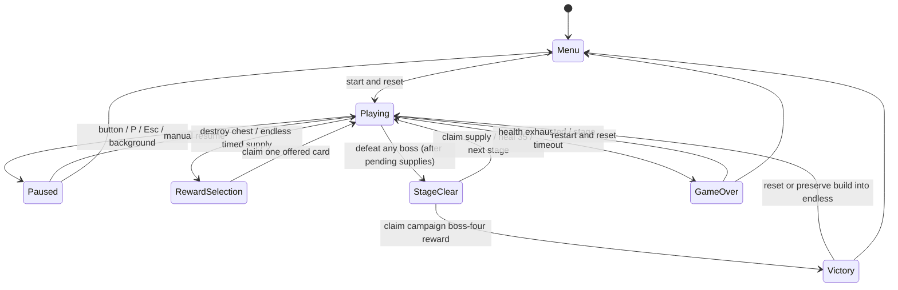

# Fixed-defense combat architecture

Echoes of Destiny is a static, run-local defense Roguelike. The player holds `(225, 736)`, fires tracking projectiles, selects priority targets and collects forty-three augment cards across ten families, including ten once-per-run epics, plus eight boss-only numeric trainings that do not belong to families. Four authored encounters lead to optional endless continuation. [Builds and stages](builds-and-stages.md) is the authoritative gameplay/parameter contract; this file defines ownership and lifecycle boundaries.

## Ownership and fixed time

- `src/game/world.ts`: run state, bounded pools, spawning, actual combat effects, rewards and endings; no Phaser, DOM, Bun or server imports.
- `src/game/config.ts`: 450 × 800 field, defense geometry, fixed step, shot/effect budgets and chest cadence.
- `src/game/systems`: targeting, movement/swept collision, attack-permission stages, shield absorption, invulnerability and continuous non-stacking poison.
- `src/game/stats.ts`: derived attack, interval, projectile, critical and lifesteal values. Base stats stay separate from family bonuses.
- `src/data`: card effects/eligibility, ten 3/6/9 family descriptions, enemy attack roles and per-stage parameters.
- `src/game/scenes`: Phaser textures, rendering and canvas input binding. `src/ui`: DOM HUD, overlays and keyboard/touch disclosure controls.

Only `Playing` advances the 1/120-second accumulator. Frame gaps cap at 100ms and backgrounding pauses instead of collecting catch-up work. No rule depends on render frames, CSS pixels or DPR. The player position is restored every step, independent of browser input. Spawns/rewards, critical hits and endless boss skill draws have independent seeded streams. Cosmetic particles consume none of them.

The fixed step first checks the control pulse, cleansing player debuffs before poison damage. Sanctuary separates player delta from hostile delta: player attacks/build effects and cumulative run time advance, while stage/deadline time, spawning, enemies, hostile shots/collisions, chests and hostile statuses stop. Its own recharge uses hostile delta. Remaining duration uses player delta and survives pause/rewards, but resets at clearance/stage/restart. Outside sanctuary, the fixed step advances clocks and enemies, refreshes targets, fires/moves projectiles, resolves swept hits and rewards, resolves periodic build effects, then enemy attacks. Friendly hits and newly applied control therefore resolve before an enemy can release an attack on that step. Any phase change stops subsequent combat settlement. Status timers, particles and visual rings advance only while combat remains active. The current stage deadline, not cumulative run time, can cause timeout.

## Targeting and projectiles

`Target` is an active living enemy or chest. Automatic ranking favors bosses, preparing/attacking enemies, approaching enemies in the danger band, chests and remaining enemies. Locks remain stable within a band and recover when an entity dies or deactivates. In endless, `tauntedTargets` first restricts candidates to living on-screen enemies granted permission by `attackPermitted`; only if this set is empty do tanks with tauntRemaining>0 force taunt. A tank inside the attack area shares that threat band. This same filter applies to automatic/manual locks, keyboard cycling, secondary-shot distribution and in-flight homing; it preserves manual preference until allowed again. Campaign input keeps its normal manual priority. Otherwise manual selection overrides automatic ranking until the target disappears or an empty click clears it. Monotonic entity IDs prevent a recycled pool object from acquiring an old lock.

The primary projectile tracks the selected target. Secondary projectiles distribute over other ranked targets and wrap when necessary; each projectile retains its own target ID and hit-ID set. Penetration seeks another valid target and cannot hit a victim twice. Tracking uses logical coordinates, angular turn rate, fixed speed and swept circle tests, with a bounded lifetime. Baseline secondary damage is 60%; family bonuses and effective counts are documented in the content contract.

Heavy/critical multipliers are applied when a volley is emitted. `primary` and `critical` projectile fields reset on pool reuse and carry the correct control trigger and rendering color. Actual damage settlement applies victim-dependent bonuses, boss charge modifiers and execution, records actual removed HP, heals direct-hit lifesteal from non-overkill damage, then either settles one death or contributes to interrupt. A lethal incoming hit ends the run before counterattacks or healing can revive the player.

Lightning/splash/periodic storms use the common enemy-damage path but cannot recursively trigger on-hit lightning/splash or drain chests. Death explosions settle through an iterative queue: every victim deactivates before enqueuing another explosion, bounding a chain by the enemy pool. Score, healing and death procs settle once. A stage transition clears pending chains immediately. Cosmetic-ring exhaustion never cancels damage.

## Enemy roles, readiness and control

Enemies have separate movement readiness (`arrived`) and attack readiness:

```text
Approaching -> permission -> Preparing -> timer expires -> Attacking
      ^            permission revoked resets preparation and pending charge
```

`AttackPolicy` supports `defense`, `region` with a y threshold and `anywhere`. Most authored melee enemies use defense permission; furnace enemies can prepare early from y=450, but melee strikes still require arrival. Wisps/sentinels directly damage the defense after arrival/preparation, with their own repeated cooldowns. They do not create misleading melee projectiles.

Hexers use region y=120 and can shoot while advancing, then stop in the midfield. Their aimed projectiles remain dangerous after the source dies, expire after six seconds/leaving bounds and use swept collision against the player's five-unit hit core. Shields absorb first; an effective incoming hit grants 0.7s invulnerability. Invulnerability suppresses repeated damage and retaliation. Nonlethal hits can trigger thorns and bastion retaliation even if shields absorb the entire hit. Sacrifice bypasses shield/invulnerability and cannot kill.

Slow scales enemy movement, preparation and attack/charge cooldown deltas. Stun freezes them. Their remaining durations consume hostile combat delta, expire normally and freeze during every non-playing phase and sanctuary. Bosses receive half slow strength and one-quarter ordinary stun duration, but full sanctuary. Reapplication takes the stronger strength/longer remaining duration rather than accumulating arbitrary duration. Projectile-hit and primary-hit counters are distinct, so frost and impact follow their stated triggers. The control pulse can clear hostile bullets before that step's enemy attacks. Every targeting entry point bypasses both taunt bands during sanctuary. Wizard poison is an active skill rather than a death proc; fusion and skill timers stop during sanctuary, and endless boss HP-threshold skills are deferred until hostile time resumes; killing the boss cancels pending skills.

Every boss entrance preserves living ordinary enemies and hostile shots. Ordinary admissions reserve one boss position. Routine 2s escort packs only fill free slots; successful admissions share the balanced species bag. Endless skill summons add six enhanced units using a scalar pending count capped by three thresholds (18), prioritize pending admissions and never replace living escorts. Boss death/reset cancels the queue. Campaign charge/interrupt/enrage timers remain independent. Endless anywhere attacks double at arrival; threshold guard/summon/slam behavior is specified in the content contract.

`systems/crowd.ts` owns endless capacity, placement, lane spacing and triple fusion. Four side lanes ×six rows yield24 minions plus the center-corridor boss; CSS/DPR never affect simulation. Births require a free upper-half location. Front-to-back advancement clamps movement to preserve84px row spacing, shifts destinations into vacancies, and leaves controls intact. Fusion needs three continuously close same-kind/same-star units; donor deactivation is not a kill, preserves the anchor ID, restores HP, multiplies stats and never exceeds three stars. Monotonic IDs invalidate donor locks on pool reuse. Temporary effects may cross units, but persistent bodies/rings/bars/stars remain separate.

Tank taunt is a finite skill field, with approach attempts and attack-phase action choices. Wizard actions select poison or ranged fire; neither ordinary shots nor deaths poison automatically. Enemy action randomness has its own seeded stream. Concentration, star and enhancement multipliers are captured in each enemy's damageScale; poison retains the stronger active potency without stacking.

## Run states and one-use rewards



Each reward contains three distinct eligible IDs, a source and a monotonic token. A chest deactivates before the collision loop freezes in `RewardSelection`. Endless stages sample three random direct-supply times once; awards occur at the end of a complete simulation step so no elapsed combat delta is lost. Each completed endless stage grants those three augments and one mixed boss reward (two trainings/one augment, choose one). Early boss death clears combat and settles missing supplies before exposing the stage reward; sequential claims pass through Playing without advancing simulation. Endless has no reward chests. A boss clears enemies, shots, pending chains and locks before a stage/victory overlay. A claim validates phase/source/token/offered membership/eligibility, consumes the capability and resumes once. `resume()` cannot bypass rewards. Several base cards remain uncapped, preserving three eligible choices after finite effects cap.

Family points sum acquired layers including duplicate upgrades. Bonuses derive from thresholds 3/6/9, rather than being permanently applied a second time. The first reward retains two foundation upgrades; later rewards favor two eligible cards in the most invested family while always keeping a foundation option. After three acquired layers, chest/supply offers have a 25% epic-promotion chance; the single augment slot in boss rewards prioritizes an eligible epic while any remain. Trainings have a separate data catalog, eligibility and stack map, and never count for synergies. The fourth boss pays its reward before Victory. Promotion favors the focused family and preserves a foundation. Epics apply compound stat changes but contribute one family point and cap at one per ID. See the content contract for the exact pool and effects.

Stage advance retains HP, shield, base stats, cards, score, kills, all three RNG progressions and cumulative time. It heals at most 35 HP and resets stage time, spawn/chest/support timers, periodic effects, volley cycle, target locks, statuses and combat pools. Victory can preserve the same build into endless. Restart restores the initial player, first stage, empty collection, fresh RNGs and zero run metrics. Entity and reward serials remain monotonic across restarts to invalidate stale references.

Campaign ordinary HP/population/escorts still compound50%. Endless base health and boss HP compound100%; ordinary population caps360 and routine packs12. Both overflow ratios strengthen minions through populationScale; HP uses P and damage/poison√P. The exponent ceiling200 prevents squared growth overflow, including star bonuses. Endless visible capacity is25 despite a28-object physical pool. See the content contract for equations.

Combat healing computes recovery and wounds first, restores missing HP, then converts overflow using additive card/blood conversion capped100%. Converted-shield capacity derives from maxHP and card/blood capacity, also capped100%. Existing direct shield is never reduced to that cap. Conditional shield lifesteal reads current shield; instant card and stage heals do not convert. Numeric training modifies base stats without granting family layers. Both collections survive stage/endless advancement and clear on restart.

## Input, presentation and budgets

`InputController` binds primary pointer contacts to the canvas. A release without a swipe selects a target; movement exceeding 12 CSS pixels cancels the gesture. Coordinates derive from the actual canvas rectangle. Added touch/mouse hit tolerance is 22/10 CSS pixels, capped at 36 logical units. Overlap selection prefers direct body hits, then normalized distance, then stable ID. Empty taps clear manual priority.

The focusable canvas supports T to cycle and C to restore automatic selection. WASD/arrows/drags cannot move the player; Tab retains DOM focus behavior. Blur, pointer cancellation, phase changes and shutdown release capture. HUD refresh preserves pause-button nodes and their displayed intent to avoid pointer/blur races. Reward/help controls do not send combat targeting input.

The navy, blue/violet and gold style remains. Blue/gold/pink rings indicate approach/preparation/attack; cyan hexers, amber shield-shaped tanks and green wizards have original procedural silhouettes. HUD poison/grievous-wounds/slow feedback, sanctuary countdowns, taunt lock labels and boss guard/skill/arrival/scaling-slam labels expose the new rules. Slow, stun and critical shots have distinct colors. A target bracket, enemy/boss HP, boss gold charge/interrupt progress, stage progress, effective stats and ten expandable family rows expose decisions. Rendering respects reduced motion without changing simulation timing. Reward/victory overlays stay bounded and scroll internally on 320px displays.

Global budgets: **28 enemies, 240 friendly shots, 360 hostile shots, one chest, 120 particles and 32 rings**. Authored simultaneous enemy caps rise from 14 through 18/21 to 28. Image/simulation pools reuse objects. Canvas backing remains 450 × 800 independent of DPR. WebGL failure/context loss shows a readable recovery state. No Canvas fallback, audio, accounts, backend, analytics service or persistence is claimed. License/third-party notices remain in the static build.

## Verification boundaries and tuning metrics

Bun tests exercise fixed position, 30/60/144 Hz equivalence, tracking/penetration, readiness and actual melee/ranged damage, boss counterplay, all forty-three augment cards and eight boss-only numeric trainings and ten tier families, once-per-run epic promotion and cleansing sanctuary, unique chain settlement, lifesteal/overheal bounds, slow/stun/boss resistance, mixed escorts, balanced 1:1:1 species, taunts, poison/slow, threshold skills, bounded summons, mixed four-reward endless stages, compounding growth, independent clocks, rewards, pause, endings and restart.

`tests/unit/run.test.ts` uses normal target inputs, offered-card choices and endless continuation. It covers a four-stage victory under actual pressure, twenty seeds with success/failure, target decisions that change an outcome and campaign-winning builds both failing in endless and naturally clearing two endless stages. Additional explicit fixtures check mixed rewards and two-stage progression. `tests/policy.ts` is a fixed test policy, not game automation; the runs do not patch HP, damage, RNG, stages or clocks. Results are not human win rates or proof of balance.

Snapshot metrics record effective incoming HP/shield loss, actual enemy HP removed, effective HP healing, critical hits, control procs, actual melee/ranged admissions, current stage admissions/quota/growth and existing kills/arrivals/specials/interrupts/procs. They support later reproducible tuning. The browser exposes only cloned snapshots in test-mode development; production excludes the diagnostic API. Nothing is uploaded or persisted.

Browser plugin not available: repository Playwright runs the real WebGL app and native desktop/touch input. Explicit fixtures cover thresholds, chains, ranged waves, mixed gold-charge encounters and final-victory/endless actions. Natural browser runs separately verify first-stage success/failure and restart; natural full campaigns/new endless failure and fixtured multi-stage endless continuation are simulation proof. Screenshots/traces remain in `/tmp`; local servers bind to loopback. README records the executed engine/viewport counts and remaining boundaries. Physical phones, long endless performance and subjective difficulty still need human acceptance.

## Player documentation contract

`src/data` and the narrative templates in `scripts/game-guide.ts` generate `docs/game-guide/`. Rule-source hashes make stale game documentation fail `bun run docs:check` and the production build. Review prose whenever combat changes; regeneration alone cannot prove semantic accuracy. The guide covers every card, enemy, tier, stage, poison grievous wounds and sanctuary. Poison reduces all HP healing by 90% while its timer is positive, including fixed card heals and combat overheal before conversion; direct shields are unaffected. `scripts/publish-wiki.ts` converts internal Markdown links for native Wiki routes and pushes only its eight managed pages, preserving other pages. Wiki publication is separate from game deployment.
