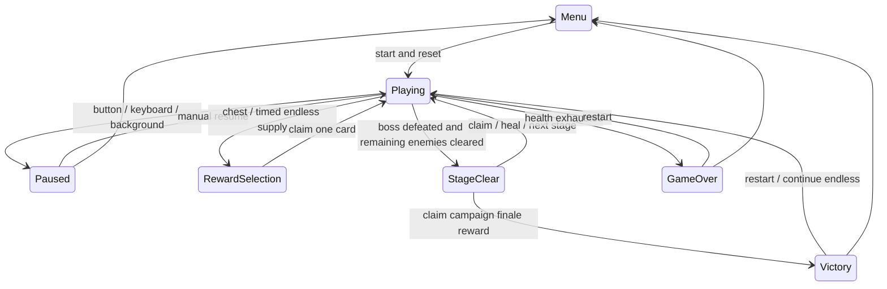

# Fixed-defense combat architecture

Echoes of Destiny is a static, run-local defense Roguelike. The fixed player at `(arena.width/2,736)` fires tracking shots and collects51 augments across12 families, including12 once-per-run epics. Eight numeric trainings are tracked separately. Four authored encounters lead to optional endless continuation. [Builds and stages](builds-and-stages.md) owns the gameplay formulas; this file defines implementation boundaries.

## Ownership and time

- `src/game/world.ts`: simulation, bounded pools, spawning, combat effects, one-use rewards and endings; no DOM, Phaser, Bun or server imports.
- `src/game/arena.ts`: portrait/desktop geometry, lanes, capacity, spatial scale and the full attack grid. Geometry is chosen from the viewport at boot and stays fixed for the run.
- `src/game/config.ts`: fixed step, timing, projectile/effect budgets and baseline parameters.
- `src/game/systems`: targeting, swept collisions, movement/readiness, formation/fusion, recovery, wounds and escalating poison.
- `src/game/stats.ts`: derived attack, firing interval, crit and lifesteal. Base stats and family modifiers remain distinct.
- `src/data`: cards, trainings,12 family descriptions, enemies and stage parameters.
- `src/game/scenes`: Phaser textures and rendering. `src/ui`: native DOM HUD, rewards/help/build dialogs and keyboard/touch disclosure controls.

Only `Playing` advances the1/120s accumulator. Frame gaps cap at100ms; losing focus pauses instead of accumulating catch-up. Player position is restored every step. No simulation rule depends on CSS pixels, DPR or render frames. Spawns/rewards, score training, critical hits, enemy actions, boss skills and new attack regions have separate seeded streams. Cosmetic particles consume none of them.

A fixed step activates sanctuary first, cleansing before potential poison damage. Sanctuary lets player attacks/healing/build effects and cumulative run time advance, while stage time, spawning, enemies, hostile projectiles/collisions, chests, statuses, fusion and supplies stop. Recharge uses hostile delta; duration uses player delta. Pause/rewards preserve remaining duration. Stage/reset clears it. Ordinary slow/stun keep boss resistances; sanctuary gives bosses its full duration and defers HP-threshold skills.

Outside sanctuary, movement and clocks precede target refresh, friendly shots/collisions, build effects and enemy attacks. Hits and new control resolve before hostile actions. Phase changes stop settlement. When the boss is defeated, no reinforcement schedule or pending summon can add new enemies; remaining minions and their bullets keep acting. A stage completes only when the boss was defeated and no active enemies remain. This check runs after friendly damage and counter/periodic effects; successful cleanup clears hazards before exposing a reward. A surviving escort can still cause GameOver.

## Geometry, permission and input

Portrait has four side lanes with six rows;1080p desktop has about six lanes with six rows, and capacity/budgets adapt. A center corridor reserves space for the boss. Initial firepower and projectile travel adapt to the wider population. Spatial effects and fusion proximity follow lane spacing; bodies and vertical spacing do not stretch. Resizing preserves the selected world, and FIT preserves rendering proportions.

`AttackPolicy` supports defense arrival, a region y threshold, anywhere on-screen, and active grid zones. Endless melee gets permission either on arrival or inside an active grid cell, and that permission enables actual damage before arrival. Ranged actors retain their ranged policy. The same predicate determines attack-area target priority. Each endless clearance adds two random inactive cells from an independent stream, preserving earlier cells until full coverage. The renderer uses those exact cells; it cannot create a cosmetic-only warning. Restart resets the active list.

Targeting restricts endless targets to actors with attack permission first, then actively taunting tanks, unless sanctuary disables both bands. Automatic/manual targets, keyboard cycling, secondary allocation and homing share the restriction. Saved manual preference resumes when legal again. Monotonic IDs prevent recycled entities from inheriting locks.

Primary shots track the selected target; secondaries distribute over other ranked targets. Each shot owns a target ID and hit-ID set. Penetration cannot hit a victim twice. Swept segment-circle tests prevent tunneling. Critical/heavy multipliers are captured at volley emission. Victim-dependent bonuses, giant size scaling, primary-only max/current-HP components, boss reduction and execution settle in the shared damage path. Recorded damage and lifesteal use actual HP removed. A lethal player hit ends the run before counters can heal it.

`InputController` binds native primary contacts to the canvas. A release selects a target; swipes above12 CSS pixels cancel. Input maps through the actual canvas rectangle and logical arena dimensions. T cycles, C clears manual selection, Tab keeps native focus, and WASD/arrows/drags do not move the player. Blur/cancellation/phase changes/shutdown release capture. HUD updates preserve pause-button nodes and displayed intent across pointer events. Opening build/help pauses; closing returns focus and requires manual resume.

## Damage, recovery and pools

Primary percentage bonuses are explicit direct-hit inputs, so secondaries, lightning, splash and retaliation cannot recursively trigger them. Pulses use each victim's own maximum HP. All use the common damage settlement for reduction, kill score and lifesteal boundaries. Chests receive only direct projectile damage.

Kill explosions capture the source monster's maxHP when queued; sacrifice captures its target's maxHP. Iterative resolution deactivates each victim before it can enqueue another explosion, bounding a chain by the enemy pool and avoiding recursion. Full-screen retaliation iterates every active enemy, independent of current target or distance. Killing the boss midway does not skip its escorts. Cosmetic-ring exhaustion never cancels actual damage.

`systems/damage.ts` owns all health/shield recovery and wounds. Fixed card shields, timed bastion shields and dominion kill shields share `grantShield`. Overheal converts already-reduced healing with an explicit flag to avoid charging wounds twice. Existing direct shields above the conversion cap are preserved. Wounds has one fixed90% penalty and a duration that can extend. Poison starts at10/s, adds duration and one random stat per repeat, and does not inherit enemy damageScale. Shield immediately suppresses its total-speed penalty; expiry/cleanse clears escalation. All statuses freeze outside Playing.

Endless formations use arena-specific lanes, admit only free upper-half positions, advance front-to-back and maintain84-unit separation. Fusion requires three continuously close same-kind/same-star units. Donor deactivation is not a kill: it grants no score/healing/explosion. The anchor ID survives, HP refills, stats grow and star count caps at3. Source IDs are never reused. Summons use a scalar queue bounded by18, preserve living actors and drain only into vacancies. Routine packs fill free slots without queue accumulation.

Global object budgets are65 enemies,240 friendly shots,360 hostile shots, one chest,120 particles and32 rings. Physical pool size supports the largest2400-wide arena; per-stage admission caps remain smaller. Units, projectiles and effects reuse pool objects. Rendering respects reduced motion independently of combat. WebGL startup/context loss shows a readable recovery state. No backend, accounts or telemetry service is introduced. Only PRE stores personal numeric profiles in origin-scoped browser storage; combat runs are not persisted. PRO reads only the reviewed profile bundled in its build.

## Rewards and lifecycle

Stage-one augments allow only barrage/might/precision/storm, including epics, before any family focus or promotion. Boss and score training exclude leech there. Other families unlock in stage two. Offers keep distinct eligible IDs and retain a foundation upgrade. Chest/supply promotion after three acquired layers and stage candidate promotion roll25%; boss augmentation samples the drawn candidates uniformly and never prioritizes an epic.

Every reward carries a monotonic token, source and eligible IDs. Claims validate phase/source/token/membership/eligibility and consume the capability before resuming. `resume()` cannot skip rewards. Missing endless supplies settle in sequence only after complete cleanup, then expose the mixed boss reward. Fourth-stage reward precedes Victory. Score milestones use a separate RNG and recompute training eligibility after every award, with no selection or score deduction.

Stage advance retains HP, shield, base stats, cards, training, score, kills, RNG progress and cumulative time. It cleanses and restores up to35HP, then resets stage timers/pools/locks/cooldowns. Active endless attack cells persist and gain two when appropriate. Restart resets all run state and active regions while keeping entity/reward serials monotonic.

## Documentation and verification

Runtime data and manual prose in `scripts/game-guide.ts` generate bilingual managed pages under `docs/game-guide`. A source hash makes stale documentation fail `docs:check` and build; regeneration cannot replace semantic review. English prose/catalog is reviewed against a pinned rule digest. Native Wiki publication converts links, copies versioned documentation assets and preserves unmanaged pages. Wiki/PRE/PRO are separate operations.

Bun regressions cover all12 family thresholds,51 augments, eight trainings, geometry, capacity, region expansion to saturation, real early melee and targeting, cleanup/failure, all rarity outcomes, strongest tank/boss HP, poison/wounds recovery, percentage damage boundaries, iterative chains, global counters, frame-rate invariance and natural campaigns/endless outcomes. Fixed policies only use real offered cards and normal target/continue actions; they never patch gameplay to win. Outcomes are examples, not human win rates.

Read-only cloned snapshots are exposed by PRE and the test-mode dev entry; PRO excludes diagnostics. The PRE-only DebugWorld subclass and DOM panel provide validated local commands without exposing a writable world on window. Each world clones its numeric profile, each enemy keeps its spawn-time numeric definition/encounter, and base simulation behavior remains unchanged by another browser or profile draft. Separate random-stream states and an entry checkpoint support repeatable retries; IDs/tokens never rewind. See [the debugger contract](balance-debugger.md). Metrics record actual dealt/taken/healed amounts, casts, hits, arrivals, kills, admissions, fusions and effects. Browser plugin not available: repository Playwright tests the real WebGL app with desktop and native touch inputs. Screenshots/traces stay in `/tmp`, servers stay loopback-only. Physical phones, long-session performance and subjective difficulty require human acceptance.

## Numeric configuration

The portable balance-v1 profile carries initial player stats, enemy numbers, endless tuning, per-source reward policies and ordered-by-specificity stage rules. Null official.json preserves the legacy defaults. The balance resolver feeds the simulation, upcoming-stage UI, enemy preparation rendering and generated numeric tables. Default guided draws retain the original shuffle and RNG consumption; custom weighted draws never reintroduce excluded cards. Exhausted reward pools display an explicit one-use continue action. Profile application is a local source change, independent from Wiki, PRE or PRO publication. PRE-only acquisition history rebuilds card stats in order, keeps direct overrides separate, and pays resource side effects only for new grants.

## Balance Simulator V1

`src/balance-sim` owns environment-independent natural-run policies, bounded collection, result types, portable case validation and canonical evidence hashing. `scripts/balance-sim` owns CLI experiment configuration, code/profile provenance, grouped statistics, paired comparisons, controlled one-factor candidates and report I/O; `scripts/balance-simulator.ts` orchestrates sequential experiments and incremental results. Runtime code never imports tests. The old natural-run policies remain explicit legacy controls.

The actual `World` exposes an optional frozen value observer at resolved settlement points; it neither supplies decisions nor consumes RNG. Enemy effective damage excludes chest/overkill; player HP loss and shield absorption, all effective recovery sources, fatal source, stage-clear before score training and post-reward recovery are distinct. Without an observer, production does not store or upload experiment records. No official numeric or combat rule changes are part of this tool.

PRE statically includes its existing debugger plus portable review validation, with no batch-runner/browser I/O coupling. A case prepares a fresh paused same-profile/seed/logical-width session using one-shot session storage, without changing persisted drafts/selected versions. PRO and ordinary development exclude the experimental UI, policies and traces. This is manual replay preparation; exact policy reproduction is a CLI operation. See [usage and metric contracts](balance-simulator.md).

## Game languages

`src/i18n/locale.ts` owns the two supported locales (`zh-CN` and `en`), defaults to Chinese and safely persists the choice at `echoes.locale`. Storage errors keep switching usable for the current page. Shell and Phaser labels subscribe to changes; GameUI invalidates presentation caches and redraws without advancing World, drawing new rewards or changing capability tokens. World keeps its Chinese diagnostic notice and a separate English version; snapshots and simulator outputs retain their existing language contract.

`src/i18n/content.ts` shares the English card and family catalog with the guide generator. Authored Chinese data and stable IDs stay intact; previews translate labels around the same numerical formulas. PRE binds translations to its own Text nodes and attributes, preserving form nodes, unsaved numeric values, disclosure state and imported review evidence. User profile names and raw JSON remain original. Both PRO and PRE store only the language preference for localization; this adds no combat persistence or backend.
