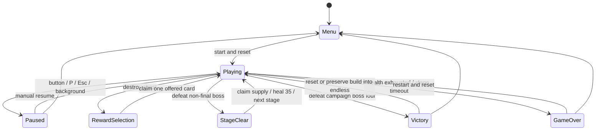

# Fixed-defense combat architecture

Echoes of Destiny is a static, run-local defense Roguelike. The player holds `(225, 736)`, fires tracking projectiles, selects priority targets and collects thirty cards across ten families. Four authored encounters lead to optional endless continuation. [Builds and stages](builds-and-stages.md) is the authoritative gameplay/parameter contract; this file defines ownership and lifecycle boundaries.

## Ownership and fixed time

- `src/game/world.ts`: run state, bounded pools, spawning, actual combat effects, rewards and endings; no Phaser, DOM, Bun or server imports.
- `src/game/config.ts`: 450 × 800 field, defense geometry, fixed step, shot/effect budgets and chest cadence.
- `src/game/systems`: targeting, movement/swept collision, attack-permission stages, shield absorption and invulnerability.
- `src/game/stats.ts`: derived attack, interval, projectile, critical and lifesteal values. Base stats stay separate from family bonuses.
- `src/data`: card effects/eligibility, ten 3/6/9 family descriptions, enemy attack roles and per-stage parameters.
- `src/game/scenes`: Phaser textures, rendering and canvas input binding. `src/ui`: DOM HUD, overlays and keyboard/touch disclosure controls.

Only `Playing` advances the 1/120-second accumulator. Frame gaps cap at 100ms and backgrounding pauses instead of collecting catch-up work. No rule depends on render frames, CSS pixels or DPR. The player position is restored every step, independent of browser input. Ordinary simulation RNG and critical-hit RNG have separate seeded streams. Cosmetic particles consume neither.

The fixed step advances stage/run clocks and enemies, refreshes targets, fires/moves projectiles, resolves swept hits and rewards, resolves periodic build effects, then enemy attacks. Friendly hits and newly applied control therefore resolve before an enemy can release an attack on that step. Any phase change stops subsequent combat settlement. Status timers, particles and visual rings advance only while combat remains active. The current stage deadline, not cumulative run time, can cause timeout.

## Targeting and projectiles

`Target` is an active living enemy or chest. Automatic ranking favors bosses, preparing/attacking enemies, approaching enemies in the danger band, chests and remaining enemies. Locks remain stable within a band and recover when an entity dies or deactivates. Manual selection overrides automatic ranking until the target disappears or an empty click clears it. Monotonic entity IDs prevent a recycled pool object from acquiring an old lock.

The primary projectile tracks the selected target. Secondary projectiles distribute over other ranked targets and wrap when necessary; each projectile retains its own target ID and hit-ID set. Penetration seeks another valid target and cannot hit a victim twice. Tracking uses logical coordinates, angular turn rate, fixed speed and swept circle tests, with a bounded lifetime. Baseline secondary damage is 60%; family bonuses and effective counts are documented in the content contract.

Heavy/critical multipliers are applied when a volley is emitted. `primary` and `critical` projectile fields reset on pool reuse and carry the correct control trigger and rendering color. Actual damage settlement applies victim-dependent bonuses, boss charge modifiers and execution, records actual removed HP, heals direct-hit lifesteal from non-overkill damage, then either settles one death or contributes to interrupt. A lethal incoming hit ends the run before counterattacks or healing can revive the player.

Lightning/splash/periodic storms use the common enemy-damage path but cannot recursively trigger on-hit lightning/splash or drain chests. Death explosions settle through an iterative queue: every victim deactivates before enqueuing another explosion, bounding a chain by the enemy pool. Score, healing and death procs settle once. A stage transition clears pending chains immediately. Cosmetic-ring exhaustion never cancels damage.

## Enemy roles, readiness and control

Enemies have separate movement readiness (`arrived`) and attack readiness:

```text
Approaching -> permission -> Preparing -> timer expires -> Attacking
      ^            permission revoked resets preparation and pending charge
```

`AttackPolicy` supports `defense`, `region` with a y threshold and `anywhere`. Most authored melee enemies use defense permission; furnace enemies can prepare early from y=450, but melee strikes still require arrival. Wisps/sentinels directly damage the defense after arrival/preparation, with their own repeated cooldowns. They do not create misleading melee projectiles.

Hexers use region y=120 and can shoot while advancing, then stop in the midfield. Their aimed projectiles remain dangerous after the source dies, expire after six seconds/leaving bounds and use swept collision against the player's five-unit hit core. Shields absorb first; an effective incoming hit grants 0.7s invulnerability. Invulnerability suppresses repeated damage and retaliation. Nonlethal hits can trigger thorns and bastion retaliation even if shields absorb the entire hit. Sacrifice bypasses shield/invulnerability and cannot kill.

Slow scales enemy movement, preparation and attack/charge cooldown deltas. Stun freezes them. Their remaining durations consume real combat delta, expire normally and freeze during every non-playing phase. Bosses receive half slow strength and one-quarter stun duration. Reapplication takes the stronger strength/longer remaining duration rather than accumulating arbitrary duration. Projectile-hit and primary-hit counters are distinct, so frost and impact follow their stated triggers. Periodic control can clear hostile bullets before that step's enemy attacks.

Every boss entrance clears the ordinary wave/hostile shots and admits the boss plus melee and ranged escorts in the same step, so a saturated ordinary pool cannot block it. Mixed support repeats every 2s while the boss lives, including during gold charges, with no total escort quota. Batch sizes compound from 4/6/7/9 in the campaign and 50% per endless transition. Each batch attempts at most the free slots, with no accumulated queue; successful escort admissions retain a one-ranged/three-melee cycle across batches. Boss death immediately clears combat and freezes stage supply/victory, regardless of remaining escorts. Boss arrival, initial preparation, special cooldown, charge, interrupt damage and half-health enrage remain independent timers. A charge releases at most once, including floating-point timer residue; enough real damage cancels it. All timers are simulation fields, without external callbacks or AI frameworks.

## Run states and one-use rewards



Each reward contains three distinct eligible IDs, a source and a monotonic token. A chest deactivates before the collision loop freezes in `RewardSelection`. A boss clears enemies, shots, pending chains and locks before a stage/victory overlay. A claim validates phase/source/token/offered membership/eligibility, consumes the capability and resumes once. `resume()` cannot bypass rewards. Several base cards remain uncapped, preserving three eligible choices after finite effects cap.

Family points sum acquired layers including duplicate upgrades. Bonuses derive from thresholds 3/6/9, rather than being permanently applied a second time. The first reward retains two foundation upgrades; later rewards favor two eligible cards in the most invested family while always keeping a foundation option. See the content contract for the exact pool and effects.

Stage advance retains HP, shield, base stats, cards, score, kills, both RNG progressions and cumulative time. It heals at most 35 HP and resets stage time, spawn/chest/support timers, periodic effects, volley cycle, target locks, statuses and combat pools. Victory can preserve the same build into endless. Restart restores the initial player, first stage, empty collection, fresh RNGs and zero run metrics. Entity and reward serials remain monotonic across restarts to invalidate stale references.

Campaign ordinary HP, population budgets and escort batch sizes compound 30% from stage one; counts round up from the unrounded baseline. Every endless transition compounds ordinary/boss HP, population budgets and escort batch sizes 50% from the finale, independently of the rotated visual theme. Regular endless admissions and all escort batches use one hexer per three melee. Spawn quota is separate from simultaneous capacity: at most one regular admission per step, free-slot-bounded support batches and 28 living enemies bound deep-endless work. A full pool can constrain realized admissions before the scheduled boss transition and clip escort batch sizes. No unbounded array of pending monsters is allocated.

## Input, presentation and budgets

`InputController` binds primary pointer contacts to the canvas. A release without a swipe selects a target; movement exceeding 12 CSS pixels cancels the gesture. Coordinates derive from the actual canvas rectangle. Added touch/mouse hit tolerance is 22/10 CSS pixels, capped at 36 logical units. Overlap selection prefers direct body hits, then normalized distance, then stable ID. Empty taps clear manual priority.

The focusable canvas supports T to cycle and C to restore automatic selection. WASD/arrows/drags cannot move the player; Tab retains DOM focus behavior. Blur, pointer cancellation, phase changes and shutdown release capture. HUD refresh preserves pause-button nodes and their displayed intent to avoid pointer/blur races. Reward/help controls do not send combat targeting input.

The navy, blue/violet and gold style remains. Blue/gold/pink rings indicate approach/preparation/attack; cyan hexers have an original procedural silhouette. Slow, stun and critical shots have distinct colors. A target bracket, enemy/boss HP, boss gold charge/interrupt progress, stage progress, effective stats and ten expandable family rows expose decisions. Rendering respects reduced motion without changing simulation timing. Reward/victory overlays stay bounded and scroll internally on 320px displays.

Global budgets: **28 enemies, 240 friendly shots, 360 hostile shots, one chest, 120 particles and 32 rings**. Authored simultaneous enemy caps rise from 14 through 18/21 to 28. Image/simulation pools reuse objects. Canvas backing remains 450 × 800 independent of DPR. WebGL failure/context loss shows a readable recovery state. No Canvas fallback, audio, accounts, backend, analytics service or persistence is claimed. License/third-party notices remain in the static build.

## Verification boundaries and tuning metrics

Bun tests exercise fixed position, 30/60/144 Hz equivalence, tracking/penetration, readiness and actual melee/ranged damage, boss counterplay, all thirty cards and ten tier families, unique chain settlement, lifesteal/overheal bounds, slow/stun/boss resistance, mixed escorts, 1:3 admissions, compounding growth, independent clocks, rewards, pause, endings and restart.

`tests/unit/run.test.ts` uses normal target inputs, offered-card choices and endless continuation. It covers a four-stage victory under actual pressure, twenty seeds with success/failure, target decisions that change an outcome and two additional endless bosses. `tests/policy.ts` is a fixed test policy, not game automation; the runs do not patch HP, damage, RNG, stages or clocks. Results are not human win rates or proof of balance.

Snapshot metrics record effective incoming HP/shield loss, actual enemy HP removed, effective HP healing, critical hits, control procs, actual melee/ranged admissions, current stage admissions/quota/growth and existing kills/arrivals/specials/interrupts/procs. They support later reproducible tuning. The browser exposes only cloned snapshots in test-mode development; production excludes the diagnostic API. Nothing is uploaded or persisted.

Browser plugin not available: repository Playwright runs the real WebGL app and native desktop/touch input. Explicit fixtures cover thresholds, chains, ranged waves, mixed gold-charge encounters and final-victory/endless actions. Natural browser runs separately verify first-stage success/failure and restart; full campaigns/endless are simulation proof. Screenshots/traces remain in `/tmp`; local servers bind to loopback. README records the executed engine/viewport counts and remaining boundaries. Physical phones, long endless performance and subjective difficulty still need human acceptance.
