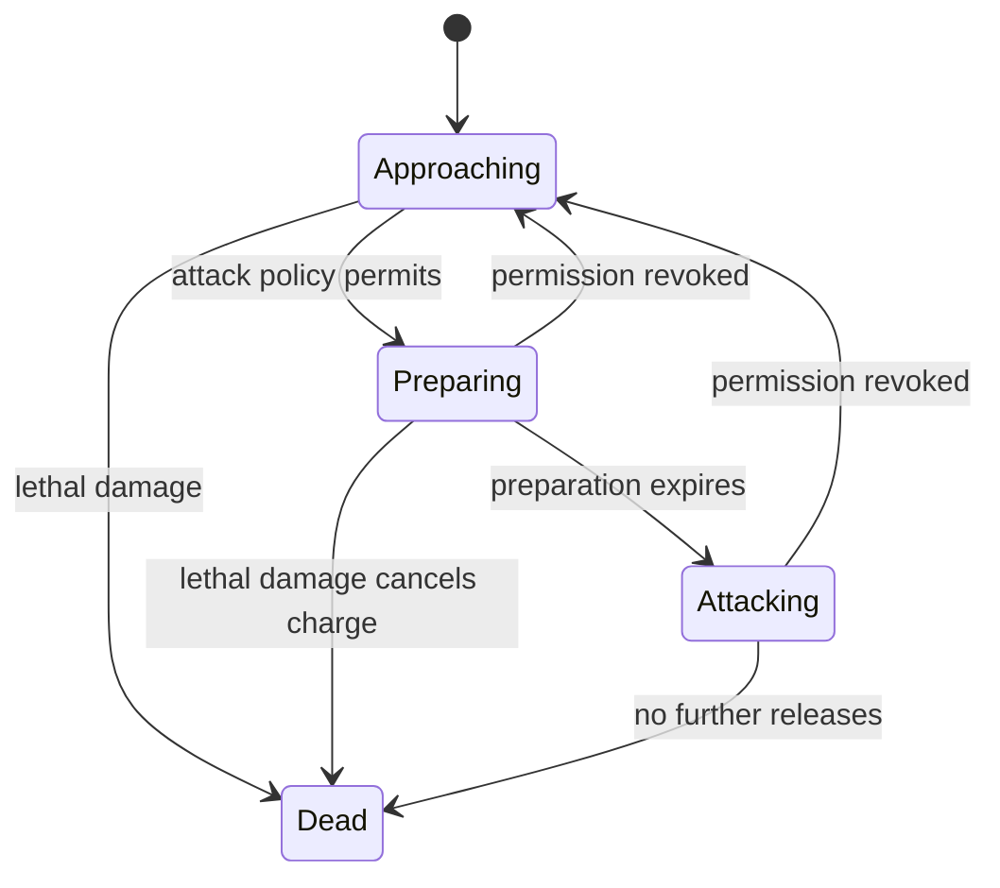
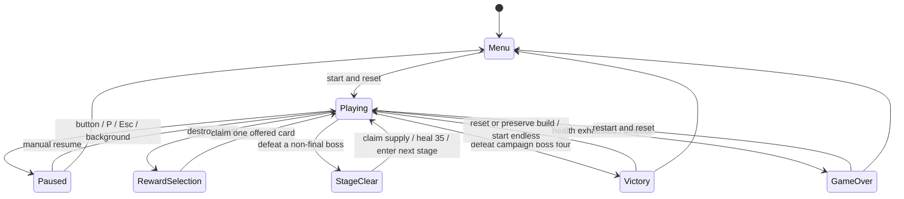

# Fixed-defense combat architecture

**Echoes of Destiny / 圣杯失控中** is a static, run-local defense Roguelike. The player holds a fixed position, tracks enemies automatically, can prioritize a target, and builds twelve cards across four consecutive encounters. The campaign takes roughly four to six simulation minutes for the tested strategies; early defeat can end sooner. Four authored bosses share the boss entity type, with distinct encounter parameters. Campaign victory offers optional endless continuation with the same build. The authoritative content contract is [Builds and stages](builds-and-stages.md).

## Boundaries and time

- `src/game/world.ts` owns the run, pools, scheduling, projectiles, rewards and endings. It imports no Phaser, DOM or Bun APIs.
- `src/game/config.ts` owns the 450 × 800 field, player position `(225, 736)`, defense geometry, danger threshold, shot and visual-effect budgets. Per-stage schedules belong to `src/data/stages.ts`. No player speed or movement bounds remain.
- `src/game/systems/enemy.ts` owns advance, arrival and attack-permission transitions. `targeting.ts` owns valid targets, threat bands and stable locks; `movement.ts` contains scalar clamping and swept collision geometry. `damage.ts` owns shield absorption and invulnerability.
- `src/data` owns enemy stats/attack policies and card effects/eligibility/previews. `src/game/scenes` renders the model in Phaser 4; `src/ui` owns semantic menus, HUD, card choices and focus.

Only `Playing` advances the 1/120-second accumulator. Rendering at 30/60/144 Hz produces the same fixed-step combat, including targeting, hostile fire and damage. Frame gaps are capped at 100 ms; backgrounding pauses rather than accumulating catch-up work. Player coordinates are restored to the configured position at every step. Input cannot move them.

A step advances total and stage time, spawns scheduled entities, advances enemies, chooses the firing target, launches and moves shots, resolves collisions, applies timed build effects, then advances enemy attack timers. A lethal friendly hit on the same step as a charge expiry cancels that unreleased attack. A reward, stage-clear or terminal transition stops further combat immediately. Explosions and retaliation use the same enemy-damage and defeat path as projectiles; dead entities deactivate before enqueuing bounded chain effects. Collision and event ordering are deterministic.

## Targeting and projectiles

Targets must be active, have positive health and intersect the visible vertical field. Selection order is:

| Band | Candidates |
| --- | --- |
| Manual | A valid player-selected enemy or chest overrides automatic threat ranking |
| 0 | Boss, or an enemy in `Preparing` / `Attacking` |
| 1 | An approaching enemy at or below danger y = 500 |
| 2 | A chest |
| 3 | Other approaching enemies |

Automatic selection keeps its current living target within a band. Only a higher priority band preempts it; a new selection breaks ties by descending y, then ascending entity ID. This prevents lock oscillation between similarly dangerous enemies. Boss arrival removes ordinary enemies; the boss outranks any surviving chest. Manual overrides remain explicit, including selecting a chest during the boss fight.

The main shot aims at the selected target. Additional shots distribute across other ranked targets, wrapping when there are fewer targets than shots; a lone boss receives the whole volley. Each secondary normally deals 60% of main-shot damage. The two-piece barrage synergy raises this to 100% and reduces the effective firing interval by 15%; the three-piece set adds a real extra volley every fourth firing event. The multishot card increases real damage and coverage without multiplying boss damage as aggressively as full-strength extra homing shots.

Friendly shots travel at 620 units/s, turn at most 10 radians/s and expire after three seconds or leaving bounds. In-flight shots keep their living target even if the player changes the next-volley priority. After a kill, disappearance or penetration hit, they acquire another valid target, excluding their own `hitIds`. With no target, they continue ballistically until expiry. Swept circle collision preserves visible flight while catching fast crossings. Every hit consumes one penetration allowance; a projectile can damage each entity only once.

References contain numeric IDs, never pooled object pointers. IDs are monotonic across both recycling and restart. Every spawn resets all enemy stage, policy, charge and arrival fields; every projectile acquisition clears hit history, target and lifetime. A recycled object cannot inherit a previous lock or charge. Replaying a seed in a fresh world reproduces the same simulation; serial IDs intentionally do not reset within an existing world.

## Defense and attack permission

Normal enemies spawn at y = -30. Seven columns have centers x = 57, 113, 169, 225, 281, 337 and 393. Two defense rows stop at y = 620 and 566. The first row is reserved before the second, preferring the free column nearest the seeded spawn position. Slots are reserved at spawn and released on death. A maximum of 14 normals fits without overlapping stopped collision circles. A full pool drops a scheduled normal spawn; it cannot prevent the boss, which clears ordinary enemies first.

Approach sway tapers to zero near a slot. On reaching its stop coordinate, an enemy clamps to the slot and sets `arrived` once. There is no old bottom-of-screen removal rule.

`stage` describes attack readiness; `arrived` separately describes movement. This permits future enemies to prepare and attack while still advancing. `AttackPolicy` is a small discriminated union:

- `defense`: permission only after reaching the assigned slot.
- `region` with `y`: permission after entering that region.
- `anywhere`: permission anywhere on screen.

Most encounters, including all bosses, use `defense`. Furnace normals and their boss reinforcements use `region` at y = 450 and can prepare before reaching their slots. Stage data selects this policy without adding another AI system. `anywhere` remains a tested extension point. A revoked permission resets preparation and any pending special. All timers live in simulation fields; no `setTimeout`, callback or external AI framework drives combat.

On permission, `Approaching` enters `Preparing` with its full configured duration. Only after that duration does it enter `Attacking` and release its first aimed volley. Later volleys use that enemy's interval. A dead enemy is skipped immediately. Already released pink shots remain dangerous after their source dies, expire after six seconds or leaving bounds, and use swept collision against the player's five-unit core. Shields absorb first; a successful hit grants 0.7 seconds of invulnerability. Nonlethal incoming hits can trigger thorns and full-bastion field retaliation even when entirely absorbed by shields. A lethal hit ends the run before retaliation or kill-healing can revive the player. Sacrifice damage is separate: it consumes at most three HP without causing death, consuming shields or granting invulnerability. No enemy body contact damage is needed across the separated defense/player positions.

## Numbers and boss counterplay

| Enemy | Base HP | Advance speed | Initial preparation | Repeat interval | Volley / damage per shot |
| --- | --- | --- | --- | --- | --- |
| Wisp | 50 | 112/s | 1.4s | 3.2s | One aimed shot / 6 |
| Sentinel | 108 | 86/s | 1.8s | 3.8s | Three-shot fan / 9 |
| Boss | 2000 | 112/s | 2s | 2.7s | Three-shot fan / 10 |

Normal HP scales by +12% per wave after the first; advance speed by +5%. Waves increase every 11 stage seconds. Authored encounters also scale health, speed, damage and spawn interval; stage one retains the original 1.4s-to-1.0s cadence. Wave, chest and boss schedules restart independently on each stage. A stationary player cannot dodge old radial/column patterns, so hostile damage and cadence are lower, and all first attacks have observable preparation.

Base player fire is 12 damage every 0.34s. Overload, haste, multishot, piercing, vitality and ward remain effective. `execution` / **防线裁决** replaces movement growth: +20% damage per stack, up to three, only against `Attacking` enemies. It applies during boss special charging because the boss is already in that stage; it does not affect approaching/preparing enemies or chests.

In the first stage, the boss spawns at second 52, at y = -55, and reaches y = 620 in about six seconds. It then prepares for two seconds, retaining its independent HP bar. This creates a real engagement window before the second-88 deadline despite accurate tracking fire.

After 2.8 attacking seconds the boss charges a special. The following values describe stage one; other bosses use the charge duration, interrupt threshold, volley fan, damage and reinforcement schedule in `src/data/stages.ts`. While charging, regular volleys pause. Dealing 90 damage within two seconds interrupts it, delays its next normal attack and shows blue/gold feedback. Otherwise it consumes the charge and releases exactly one aimed heavy projectile for 26 damage, even when timer subtraction leaves a floating-point residue. Below half HP the special needs 120 damage within 1.7s and deals 30 damage; normal attack intervals shorten by 20%. Released specials recharge for 4.5s / 3.6s, interrupted specials for 4s / 3.2s. Focused damage, execution and shields/health provide practical counterplay; old radial volleys and unavoidable multi-column barrages are removed.

The first chest appears off-center at `(110, 240)` at second 5, has 36 HP, and drifts slowly until y = 340. Later x positions are seeded, at least ten seconds apart, while no chest is active and the next scheduled stage time is at most `min(46, bossAt - 5)`. A chest remains attackable until destroyed. Stable auto targeting provides access; manual targeting can trade immediate defense pressure for an earlier upgrade.

## Run states and reward lifetime

A chest deactivates before granting a reward. Collision processing stops immediately, freezing enemy movement, preparation, cooldowns, projectiles, particles and elapsed time. `resume()` cannot bypass `RewardSelection` or `StageClear`. Stage supplies use the same one-use reward contract with source `stage`; choosing a supply advances exactly one stage. A boss clears enemies, projectiles, pending chains and target locks before the overlay appears. Each reward contains three distinct eligible IDs, a source and a monotonic token; a claim validates phase, token, offered membership and eligibility, then consumes the capability before resuming. Overload/vitality/ward always remain eligible, so three choices remain available after other cards cap. One slot prioritizes an unowned card from an already collected family when eligible; every offer includes a direct offense option. Repeated copies never count twice toward a synergy. All tier effects are derived from the current collection rather than permanently multiplying base stats.

Stage advance retains health, shield, base stats, cards, RNG progression, total elapsed time, kills and score; it heals up to 35 HP and resets only the stage clock, schedules, combat timers, locks and pools. Victory can continue into cycling authored themes with increasing health and damage.

Restart resets health, fixed coordinates, buffs, locks, rewards, pools, timers, score, RNG and combat counters. Entity and reward serials remain monotonic to invalidate stale references. The first lethal event resolves the run and later processing stops.

## Input, presentation and resource budgets

`InputController` listens on the canvas for primary pointer contacts and focused `T` / `C` keyboard commands. A release without a swipe selects a target; movement exceeding 12 CSS pixels cancels the gesture. Coordinates use the actual canvas rectangle, not CSS pixel positions or device DPR. Added hit tolerance is 22 CSS pixels for touch, ten for mouse, capped at 36 logical units. Overlapping candidates prefer a direct body hit, then normalized distance, then stable ID. An empty tap clears manual priority.

There are no WASD, arrow-key or movement-drag listeners. The focusable canvas offers T to cycle targets and C to return to automatic selection; Tab and DOM controls retain their normal behavior. State changes, blur, pointer cancellation and scene shutdown release pending capture. Reward/pause/help controls do not send combat targeting input. The displayed pause-button intent prevents blur/click races. HUD refreshes preserve native button/SVG nodes.

The existing dark navy, blue/violet and gold visual language remains. A labeled gold defense band and marked slots replace the movement-zone boundary. Blue rings mean approach, gold progress rings mean preparation, pink rings mean attacking. A blue automatic or gold manual bracket shows the current target. Small enemy HP bars, a boss charge line/progress bar and DOM target/threat labels make the decisions visible. Rendering respects reduced-motion preferences for rotation and hit shake; timing does not depend on those preferences.

Budgets: 14 enemies, 240 friendly shots, 360 hostile shots, one chest, 120 particles and 24 explosion-ring effects. Explosion resolution uses an iterative queue; every victim can enqueue at most once per death, bounded by the 14-enemy pool. Cosmetic effect exhaustion never suppresses combat damage. Simulation and image pools reuse objects. Stars/sigils are cached procedural textures. Canvas backing stays 450 × 800 on high-DPR devices. The app preflights WebGL and shows a readable recovery screen if unavailable or lost. No Canvas fallback, backend, accounts, remote API, audio or persistence is claimed. Font and dependency notices remain with the static build.

## Verification contract

Bun tests cover fixed position, cross-field and chest hits, stable/manual/recovered locks, actual multishot damage, two-target penetration without repeat hits, lost-target expiry, arrival/preparation/first and repeated volleys, death cancellation, released-shot damage, configurable policies, full defense capacity, pool recycling, boss advance/special/interrupt/half-health behavior, all twelve cards, every synergy threshold and actual combat proc, finite explosion chains, shield caps, independent stage clocks, reinforcement spawns, stage supplies, endless continuation, frozen combat, rewards, endings, restart and 30/60/144 Hz equivalence.

`tests/unit/run.test.ts` uses only normal target selection and offered card choices. It verifies a full seed-4 four-stage victory under normal-enemy pressure and boss counterplay, a 20-seed success/failure sample, target decisions that change an outcome, and a family-building run through two additional endless bosses. It does not move the player or patch HP, damage, RNG, clock or waves. The sample measures these fixed policies; it is not an estimated human win rate.

Browser plugin not available: Playwright runs the real WebGL game using native keyboard, mouse and touchscreen input. Chromium exercises a natural first-stage clear into stage two and a natural failure; the full campaign and two endless bosses are exercised in simulation tests. Every desktop engine verifies final-victory/endless and chain-explosion fixtures; every desktop engine exercises target selection, defense preparation/damage, a boss special, rewards, pause races, static build and final-shot/restart fixtures. Fixture coverage is named separately from unmodified natural runs. Mobile Chromium covers high DPR, canceled swipes, touch tolerance, both rows of a full 14-enemy defense, 320px cards, bounded scrollable stage supplies and the final endless action. Browser diagnostics expose only cloned snapshots in the test-mode dev server; production removes them.

Screenshots/traces live under the system temporary directory. Test servers bind only to loopback. On this VPS, Firefox/WebKit need Xvfb and software WebGL; the README records actual executed checks and their boundaries. Browser emulation does not establish acceptance on physical Android/iOS or long-running low-end devices.
