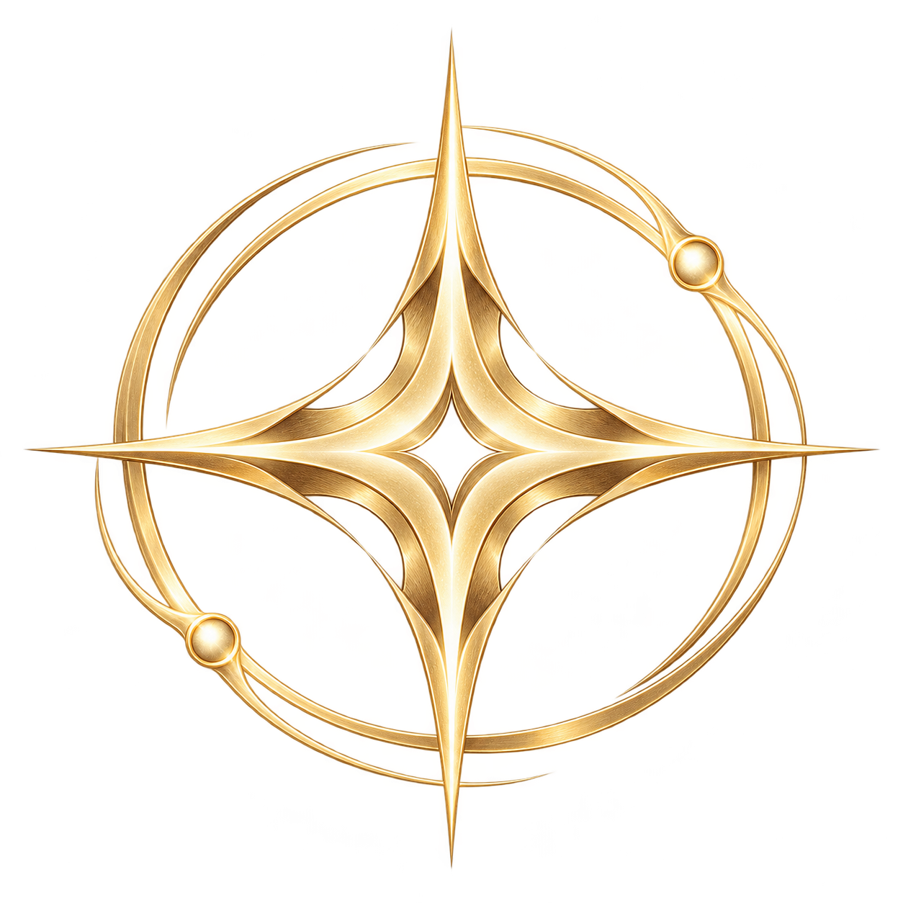

<!-- Generated by bun run docs:generate. Rules SHA-256: 82fcca90927899a0bad9d95074baea2d8486976bb17d2931c0aa62174d43b7b0 -->

# Brand and logo versions

English · [简体中文](Brand-zh-CN.md)

[Home](Home.md) · [Cards](Cards.md) · [Builds](Builds.md) · [Enemies](Enemies.md) · [Stages](Stages.md) · [Mechanics](Mechanics.md) · [Development](Development.md) · [Changelog](Changelog.md) · [Gallery](Gallery.md) · [Brand](Brand.md) · [Validation](Validation.md)

*Rewrite fate in the echoes.*


The documentation logo refines the existing four-point star and circular orbit into **Echo Compass**: a midnight field, antique gold, a negative-space diamond and offset echo rings. The SVG has a 512-unit viewBox and 2048×2048 default size; it remains sharp at any export resolution. This update uses it only in documentation. The game's favicon, emblem and art remain unchanged.

| Version | Asset | Purpose |
| --- | --- | --- |
| v0 | [Original SVG](../assets/brand/echoes-mark-v0.svg) | Archived current game favicon |
| v1 | [AI concept PNG](../assets/brand/echoes-emblem-ai-v1.png) | Built-in image_gen exploration, native 1254×1254 transparent RGBA |
| v2 | [Editable SVG](../assets/brand/echoes-mark-v2.svg) | Hand-authored documentation mark, informed by v0/v1; resolution-independent |



The v1 prompt requested at least 2048 px, but the built-in tool delivered 1254 px. The original is preserved without claiming it is a 2K/4K image. v2 supplies a scalable master for high-resolution documentation. The tool did not expose a model version or seed; generation is not deterministic.

## Exact v1 prompt

```text
Use case: logo-brand
Asset type: high-resolution documentation emblem for the open-source browser game Echoes of Destiny (Chinese name 命运残响).
Primary request: Create a polished, memorable celestial emblem inspired by the project's existing four-point gold star inside a thin circle. Evolve it into a precise, refined identity: a luminous four-point compass star with a small negative-space diamond at its heart, and two delicately offset orbital echo rings suggesting repeating fate. Keep a strong readable silhouette at small sizes.
Style/medium: premium fantasy game emblem, clean vector-like edges with subtle brushed antique-gold highlights, disciplined geometry, restrained elegance.
Composition/framing: a single centered isolated emblem, square canvas, generous clear space, no layout sheet, no mockup.
Color palette: antique champagne gold (#dec28a), warm ivory highlights; transparent background intended for a dark midnight-navy documentation page.
Text: none, no letters, no words.
Constraints: original design; preserve the four-point-star and ring idea; no characters, shields, weapons, crowns, UI, watermark, or extra pictograms. Real transparent background. Deliver at the highest available native resolution, ideally 2048 x 2048 or above, with clean alpha edges.
```

Generated 2026-10-22 through the built-in image_gen tool. Files and prompt are committed together. Future versions should keep prior masters and add a filename, date, prompt, tool, actual dimensions and usage record before changing references. The hand-authored v2 source is the SVG itself. These original project documentation assets use the repository's AGPL-3.0-or-later terms. [Asset registry](https://github.com/KnowSky404/destiny-echo-web/blob/main/docs/assets/brand/README.md).
