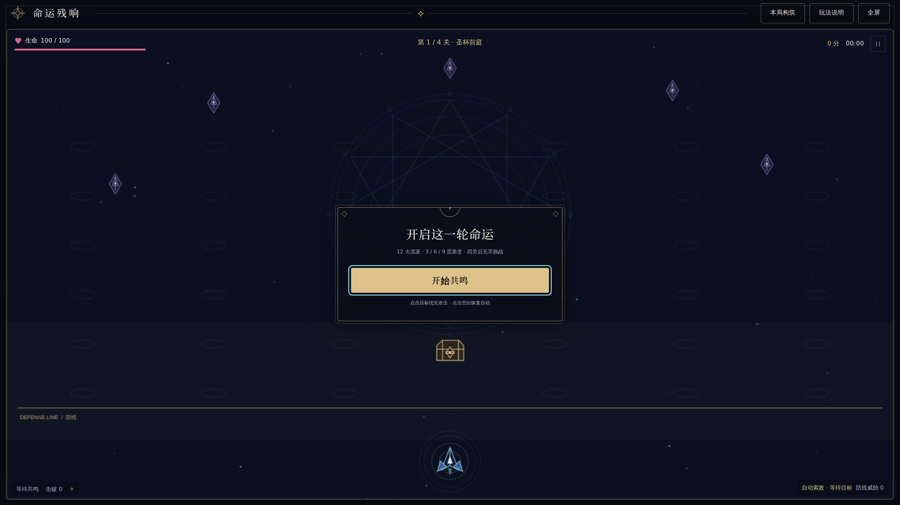
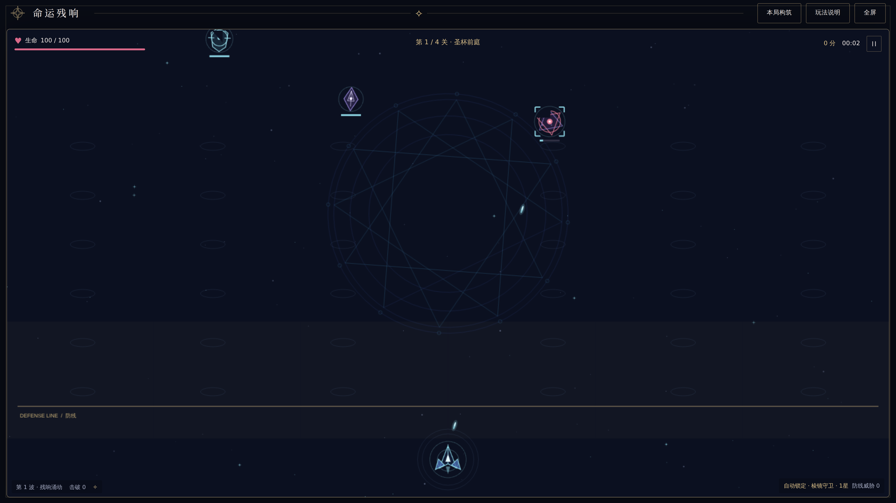
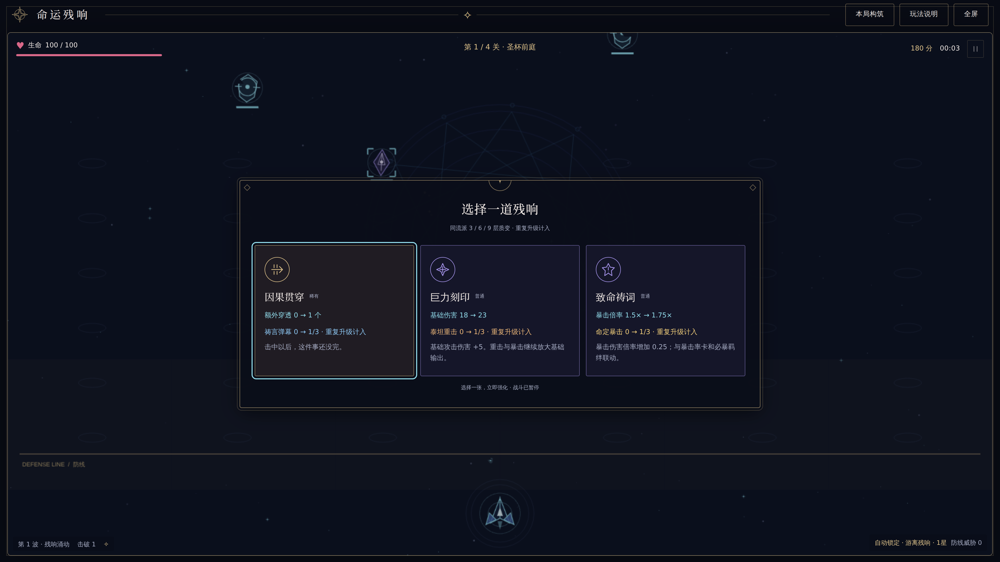
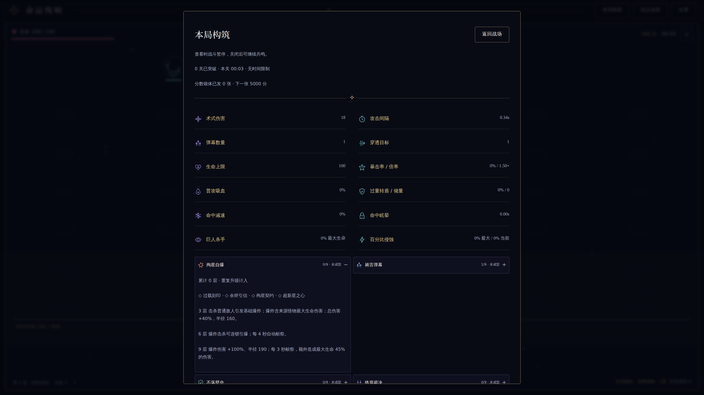
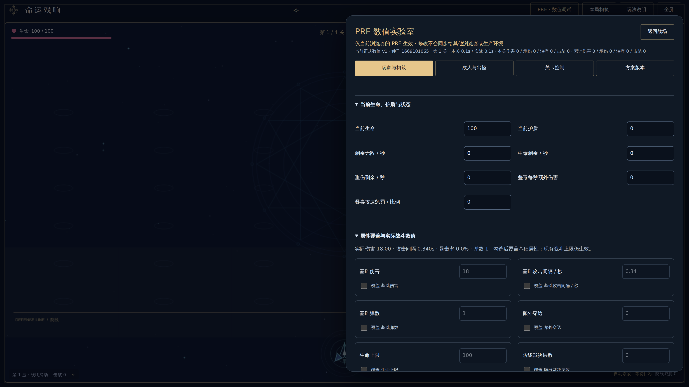
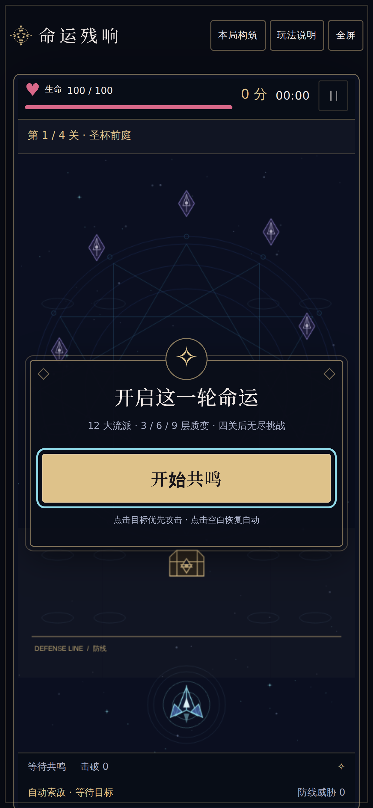

<!-- Generated by bun run docs:generate. Rules SHA-256: 74086f5ada5dc53e48846726f81cec17e90e7f6cf342c4f2c6aa87abb2854b7a -->

# Illustrated guide and capture notes

English · [简体中文](Gallery-zh-CN.md)

[Home](Home.md) · [Cards](Cards.md) · [Builds](Builds.md) · [Enemies](Enemies.md) · [Stages](Stages.md) · [Mechanics](Mechanics.md) · [Development](Development.md) · [Changelog](Changelog.md) · [Gallery](Gallery.md) · [Brand](Brand.md) · [Validation](Validation.md)

These are real application screenshots captured on 2026-10-22 from local builds of source `6ec7328` (game content unchanged in the documentation branch). They show the current Chinese UI. Desktop PNGs are **3840×2160**, rendered at viewport 1920×1080 with deviceScaleFactor 2; mobile is **1170×2532**, viewport 390×844 at scale 3. No post-capture upscaling, fabricated screens or AI gameplay illustrations are used. The game's internal render resolution remains independent of DPR.

## Start and controls



Choose 开始共鸣 to begin. The top toolbar opens the build and help panels; both pause play.

## Combat and enemies



The ship stays at the bottom. Click an enemy or chest to focus; click empty space to clear. Ring colors and attack permission are explained in [Mechanics](Mechanics.md).

## Reward draft



This offer is reached through normal play and chest targeting. The capture does not alter damage, health or rewards.

## Current build



本局构筑 shows stats and families. Expand a family to inspect its cards and thresholds; close and manually resume.

## Endless illustration


**Debug illustration:** entered with the actual PRE stage-jump control. This demonstrates attack cells and the UI; it does not claim a natural campaign clear or a balanced endless build.

## PRE laboratory



The laboratory exists only in PRE. It stores personal configuration in this browser, separately from game combat state and PRO.

## Touch layout



This is Chromium touch emulation, not a photograph or physical-phone certification.

## Reproduce and version

Browser plugin not available; repository Playwright Chromium was used with software WebGL. Build both outputs, install matching Chromium, and start loopback preview servers in separate terminals:

```sh
bun run build
bun run build:pre
bunx --bun playwright install chromium
bun run preview --host 127.0.0.1 --port 4197 --strictPort
bun run preview --outDir dist-pre --host 127.0.0.1 --port 4198 --strictPort
# In another terminal:
bun run docs:screenshots
```

The capture script exercises actual controls, checks page identity, nonblank canvas, absence of Vite error overlays, application console/page errors and failed resources. It uses a fresh context and fixed clock per capture flow; reward randomization may still differ across revisions. Set `DOCS_PRO_URL` / `DOCS_PRE_URL` to override local URLs. Keep `PLAYWRIGHT_BROWSERS_PATH` consistent if using a writable temporary installation. Inspect all images before publication.

Files are versioned under `docs/assets/screenshots`; the capture command explicitly refreshes v1. To retain a new visual revision, change the filenames and references together before capture. Images are original project captures under the repository license, including existing third-party notices. Wiki publishing copies these source PNGs without resizing. Open an image for its native resolution. See [Brand](Brand.md) for the separate logo masters.
