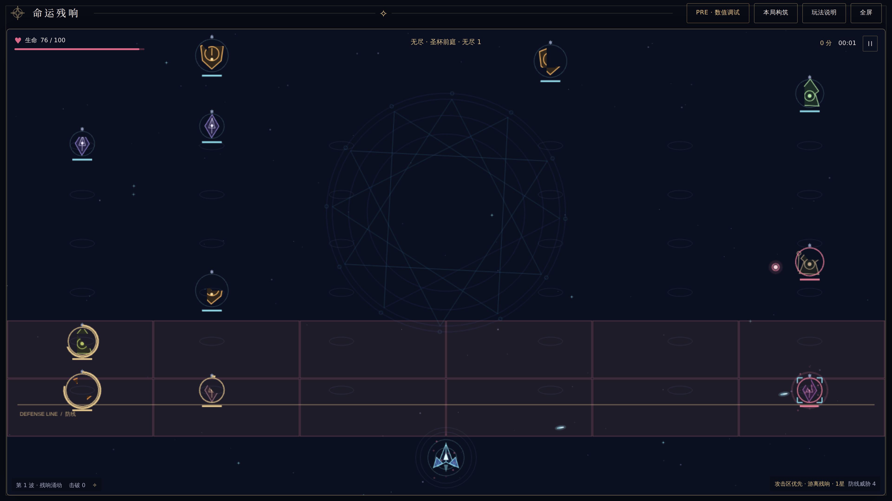

# Stages and endless mode

## Four-stage campaign

Each encounter has its own clock and boss, with no time limit. Sanctuary freezes stage time. Defeat the boss and all minions, then pick one of two trainings and one augment. Stages 1–3 cleanse and restore up to 35 HP, retaining build, shield and score. Stage four offers its reward before victory and optional endless continuation.

{{STAGE_TABLES}}

The first two tables cover campaign encounters; the last table gives the first four endless layers. Values use the four-lane mobile baseline.

Campaign minion HP uses the independently calibrated multiplier shown for each encounter; routine budgets retain 50% growth per stage. Wave HP adds ×(1 + (wave−1) ×0.12). Waves advance every 11s up to wave 5, including escorts at spawn time. Attack timing multiplies ordinary intervals and initial preparation. The boss interval shown already includes the boss base interval, stage boss interval multiplier and attack timing multiplier; charge duration uses its separate table value. Below half HP, campaign bosses multiply ordinary interval by 0.8, shorten charge by 0.3s, round interruption threshold ×4/3, and add 4 base charged-shot damage before the stage damage multiplier.

## Endless scaling

Let d=1 mean the first endless stage after the finale, with growth G = `{{ENDLESS_GROWTH}}`. Endless uses the original finale template and current endless settings; individual campaign calibrations do not replace this baseline:

- Minion HP multiplier: `{{ENDLESS_HP}}`, then wave, stars and enhanced-summon multipliers.
- Boss HP takes the greater of original growth `{{ENDLESS_BOSS_GROWTH}}` and 1.25× the strongest same-stage tank HP, rounds it, then multiplies by the boss base-HP adjustment {{ENDLESS_BOSS_HP_SCALE}}. The tank reference uses wave 5, enhanced summon and three-star fusion.
- Routine budget N = `{{ENDLESS_BUDGET}}`.
- Escort batch S = `{{ENDLESS_SUPPORT}}`, attempted every {{ENDLESS_SUPPORT_INTERVAL}}s.
- Compression P = `{{ENDLESS_COMPRESSION}}`. Excess counts become minion HP ×P and ordinary damage ×√P; poison ignores it.
- Ordinary damage multiplier: `{{ENDLESS_DAMAGE}}`. Minion speed stays ×{{ENDLESS_SPEED}}.
- Boss appears at {{ENDLESS_BOSS_AT}}s; themes repeat while stats grow, without a timeout.
- Ordinary attacks and slam share damage multiplier {{ENDLESS_DAMAGE_MULTIPLIER}}. Ordinary attacks/preparation multiply timing by `{{ENDLESS_TIMING}}`; slow and below-half boss timing still apply. Poison starts independently at {{ENDLESS_POISON_DPS}} damage per second.
- Slam directly removes `{{ENDLESS_SLAM}}` player HP, ignoring shield/invulnerability and unrelated stage/arrival damage multipliers.

## Arena, capacity and attack cells

Mobile uses a 450×800 world with four side lanes, six rows per lane: 24 minions plus one boss. Desktop selects width 800–2400 at height 800; 1920×1080 gives roughly 1505×800 and six lanes, 36 minions plus a boss. Center corridor 136 units, row spacing 84. Routine budgets, escort batches and numeric caps scale by lane count / 4. Actual encounter admission never exceeds physical capacity.

Geometry is previewed at page entry and recalculated from the current viewport on a new start or restart. Resize, pause, stage transitions and Endless continuation preserve the current run's lanes and attack cells. A 68×84 logical formation cell maps to screen pixels through the actual canvas CSS scale; DPR never changes combat. Area effects and fusion scale with lane spacing; initial damage scales with lane population and friendly shot speed with √(world-width ratio). Bodies/vertical spacing do not stretch. When no vacancy exists, spawns wait; death/fusion allows forward compaction. Skill summons queue at most {{ENDLESS_PENDING_SUMMONS}} slots and cancel on boss death.

The enemy area contains lane count ×7 cells, excluding the player row. Initially the bottom two enemy rows are open. Each endless clearance uniformly adds two distinct inactive cells, preserving them for the run; open all remaining cells if fewer than two, and stop at full coverage. Blue/gold star positions, corner marks and faint connecting lines show each open cell's actual bounds; HUD shows open/total. Melee can prepare and deal damage inside open cells before final arrival; arrival permission also remains. Ranged/boss policies persist. Pause, rewards and resize do not reroll cells; restart restores initial coverage.

## Endless boss skills

First reaching 70%, 40% and 10% HP independently rolls one of three equally likely skills; repeats are allowed.

| Skill | Effect |
| --- | --- |
| Damage ward | 90% reduction against all damage for 3s; repeating refreshes it |
| Enhanced summon | {{ENDLESS_SUMMON_COUNT}} extra balanced minions, HP/damage ×{{ENDLESS_SUMMON_MULTIPLIER}}, preserving existing escorts; wait for vacancies, at most {{ENDLESS_PENDING_SUMMONS}} pending slots |
| Slam | Directly remove {{ENDLESS_SLAM}} HP; can kill through shield and hit invulnerability |

A nonlethal hit crossing several thresholds resolves each in order; a dead boss casts nothing. Slow/stun cannot stop these skills; Sanctuary defers them and a kill during it cancels pending casts. Ordinary shots emitted after arrival deal double damage; existing shots retain their captured damage.

## Endless rewards

{{ENDLESS_SUPPLIES}} direct choose-one-of-three supplies are scheduled randomly between 3s and five seconds before the boss. After full cleanup, one mixed boss reward brings the total to {{ENDLESS_TOTAL_REWARDS}} choices per stage. Every 5,000 cumulative points separately grants automatic training. Early clearance settles missing supplies before the boss reward, recalculating eligibility each time. Endless has no reward chests. Pause/selection does not spend supply time.
